# Enemigos

**Limits Breaker** tiene dieciocho enemigos repartidos en cuatro mundos. Cada uno lleva un **ataque básico** y una **defensa**; los fuertes y los élites añaden una tercera habilidad, y algunos débiles y ordinarios también. El **Coloso de Hueso** (miniboss del encuentro 5) y **Limitless** (jefe del encuentro 10) tienen cuatro.

## Cómo leer las fichas

- **Vida:** HP máximos del enemigo.
- **Armadura:** defensa contra daño físico. **Resistencia mágica:** defensa contra daño mágico.
- **Debilidad:** multiplicador que recibe ese tipo de daño. `×1,25` significa un 25 % más; `—` significa que no tiene debilidad.
- **Daño base:** daño de la habilidad **antes** de la defensa del jugador, del +2 que recibe el enemigo cuando el jugador está a 50 % de HP o menos, de la furia, de la marca y del escalado por número de atacantes. En los ataques múltiples, el daño indicado es **por golpe**.
- **Sin efecto:** el ataque no aplica ningún estado ni modifica el combate más allá del daño.
- **Sprite:** todas las fichas usan un PNG estático con alfa. Las variantes y enemigos añadidos tienen retratos propios; su color de combate se conserva en el halo y no tiñe la ilustración.

## Cómo eligen sus habilidades

El **primer turno** de cada encuentro siempre usa el ataque básico. Después, la IA pondera ataque 1,5, defensa 1,0, habilidad especial 0,9 e invocación 0,75. Repetir la misma habilidad reduce su peso a 0,2 y no se puede defender dos veces seguidas.

La defensa aplica su guardia al inicio del turno: el enemigo no ataca ese turno, pero la guardia absorbe el siguiente golpe recibido hasta agotarse. La guardia no se acumula por encima del máximo activo. La intención se anuncia con un prefijo visible: **ATAQUE**, **DEFENSA**, **CURA**, **POTENCIA**, **MALDICIÓN** o **INVOCACIÓN**, con variantes como **ATAQUE · MARCA**. Los efectos de curación, furia, maldición, marca, drenaje, múltiple, perforación e invocación se explican en [GAME_DESIGN.md](GAME_DESIGN.md#habilidades-enemigas-y-estados). Los derrotados siguen visibles durante el turno de su muerte y los dos turnos siguientes, y desaparecen al comenzar el tercer turno posterior, después de dos turnos completos.

## Tipo de cuerpo e inmunidades

Cada enemigo tiene una o varias etiquetas de cuerpo. Las técnicas del jugador consultan esas etiquetas para decidir si aplican sus estados:

| Tipo | ¿Sangrado? | ¿Flujo de magia? |
|---|---|---|
| Vivo | Sí | Sí, salvo que además sea Mágico |
| No muerto | No | Inmune |
| Constructo | No | Inmune |
| Mágico | Sólo si además es Vivo | Inmune |

Un enemigo **Vivo · Mágico** puede sangrar, pero no recibe Flujo. Los no vivos (No muerto, Constructo o Mágico sin Vivo) no sangran. La Mutilación y la Debilidad no dependen del tipo de cuerpo: se aplican a cualquier enemigo que sobreviva al golpe.

| Enemigo | Tipo | Flujo | Sangrado |
|---|---|---|---|
| Esqueleto de Cripta | No muerto | Inmune | No |
| Acólito del Juramento | Vivo | Sí | Sí |
| Peregrino de Hueso | No muerto | Inmune | No |
| Bandido de la Marca | Vivo | Sí | Sí |
| Encadenado de Plomo | No muerto | Inmune | No |
| Cultista Carmesí | Vivo · Mágico | Inmune | Sí |
| Bandido de Ceniza | Vivo | Sí | Sí |
| Guardián de Brasas | Constructo · Mágico | Inmune | No |
| Guardián de Hierro | Constructo · Mágico | Inmune | No |
| Sabueso de Escoria | Vivo | Sí | Sí |
| Sacerdote de Escoria | Vivo · Mágico | Inmune | Sí |
| Coloso de Hueso | No muerto | Inmune | No |
| Coro Hueco | Mágico | Inmune | No |
| Polilla de Cal | Vivo · Mágico | Inmune | Sí |
| Centinela de la Grieta | Mágico | Inmune | No |
| Guardiana de la Campana | Vivo | Sí | Sí |
| Erudito del Espejo | Vivo · Mágico | Inmune | Sí |
| Limitless | Mágico | Inmune | No |

## Cripta de los Juramentos · encuentros 1–3

Pool normal: **Esqueleto de Cripta**, **Acólito del Juramento**, **Peregrino de Hueso**, **Bandido de la Marca** y **Encadenado de Plomo**. Élite desde el encuentro 3: **Cultista Carmesí** (35 % de probabilidad). El primer encuentro es individual; después los grupos tienen hasta cuatro enemigos.

### Esqueleto de Cripta

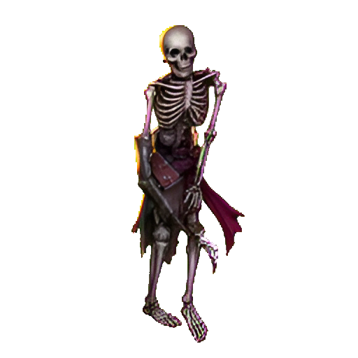

**Débil** · 15 HP · Armadura 0 · Resistencia mágica 0 · Debilidad: magia ×1,25 · XP 5  
**Sprite:** `assets/art/characters/skeleton.png` · sin tinte.

| Habilidad | Tipo | Daño base | Efecto |
|---|---|---:|---|
| Filo de costilla | Ataque | 6 | **Sin efecto** |
| Guardia de hueso | Defensa | — | Gana 4 de guardia hasta el próximo golpe recibido. |

Huesos viejos sostenidos por rencor. Frágil, pero no perdona un error.

### Acólito del Juramento

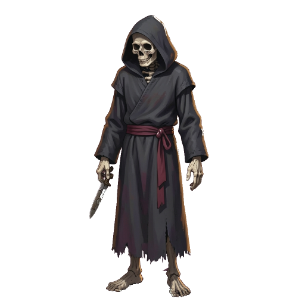

**Débil** · 18 HP · Armadura 0 · Resistencia mágica 0 · Debilidad: física ×1,15 · XP 5  
**Sprite:** `assets/art/characters/oath_acolyte.png` · acento de combate `#d8c79a`.

| Habilidad | Tipo | Daño base | Efecto |
|---|---|---:|---|
| Golpe ritual | Ataque | 7 | **Sin efecto** |
| Plegaria de polvo | Defensa | — | Gana 5 de guardia hasta el próximo golpe recibido. |
| Aliento de juramento | Ataque · Drenaje | 4 | Se cura la mitad del daño infligido. |

Canta una promesa que la cripta contesta con polvo. El drenaje le permite sostener peleas largas si no se le interrumpe.

### Peregrino de Hueso

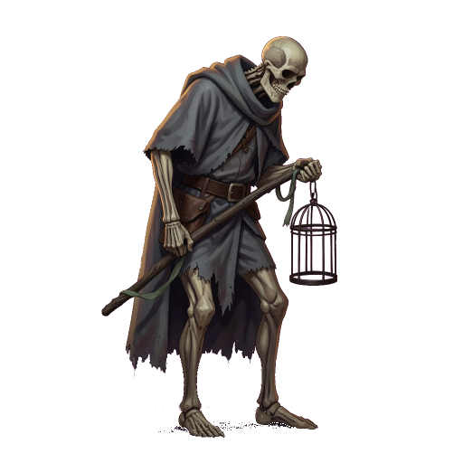

**Ordinario** · 28 HP · Armadura 0 · Resistencia mágica 0 · Debilidad: magia ×1,20 · XP 10  
**Sprite:** `assets/art/characters/bone_pilgrim.png` · acento de combate `#b9c9a8`.

| Habilidad | Tipo | Daño base | Efecto |
|---|---|---:|---|
| Bastón de hueso | Ataque | 8 | **Sin efecto** |
| Carga de reliquia | Defensa | — | Gana 5 de guardia hasta el próximo golpe recibido. |

Camina hacia una reliquia que ya no está en ninguna parte. También aparece en el Santuario de la Campana Rota.

### Bandido de la Marca

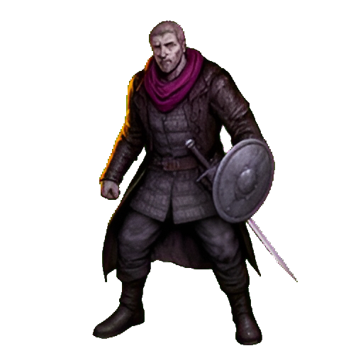

**Ordinario** · 30 HP · Armadura 0 · Resistencia mágica 0 · Debilidad: magia ×1,15 · XP 10  
**Sprite:** `assets/art/characters/brigand.png` · sin tinte.

| Habilidad | Tipo | Daño base | Efecto |
|---|---|---:|---|
| Cuchillada | Ataque | 9 | **Sin efecto** |
| Cubrirse | Defensa | — | Gana 6 de guardia hasta el próximo golpe recibido. |

Acero oxidado y una sonrisa torcida. Vive de lo que arranca a los caídos.

### Encadenado de Plomo

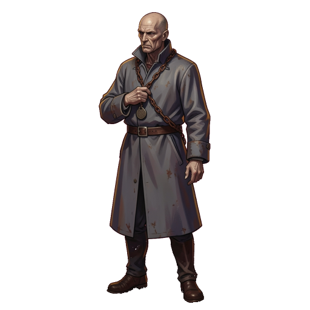

**Ordinario** · 31 HP · Armadura 1 · Resistencia mágica 0 · Debilidad: magia ×1,15 · XP 10  
**Sprite:** `assets/art/characters/lead_bound.png` · retrato propio.

| Habilidad | Tipo | Daño base | Efecto |
|---|---|---:|---|
| Golpe de plomo | Ataque | 9 | **Sin efecto** |
| Guardia encadenada | Defensa | — | Gana 7 de guardia hasta el próximo golpe recibido. |
| Cadena de retorno | Ataque · Marca | 5 | Marca al jugador: +2 de daño recibido durante 2 turnos. |

La cadena sigue arrastrándose cuando el cuerpo se detiene. Su marca vuelve peligroso dejarlo para el final.

### Cultista Carmesí · élite

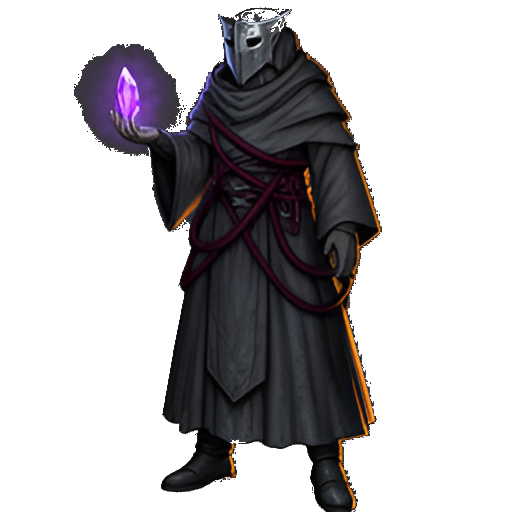

**Élite** · 48 HP · Armadura 1 · Resistencia mágica 2 · Debilidad: física ×1,20 · XP 26  
**Sprite:** `assets/art/characters/cultist.png` · sin tinte. Aparece como élite de la Cripta desde el encuentro 3.

| Habilidad | Tipo | Daño base | Efecto |
|---|---|---:|---|
| Filo carmesí | Ataque | 15 | **Sin efecto** |
| Círculo de ceniza | Defensa | — | Gana 8 de guardia hasta el próximo golpe recibido. |
| Llamado carmesí | Invocación | — | Invoca un Esqueleto de Cripta si el grupo tiene espacio (máximo cuatro enemigos). |

Dibuja símbolos con ceniza. Su dios no responde, pero algo sí. El llamado obliga a decidir entre cerrar la herida del cultista o detener al esqueleto que acaba de llegar.

## Galerías de Ceniza · encuentros 4–6

Pool normal: **Bandido de Ceniza**, **Guardián de Brasas**, **Guardián de Hierro** y **Sabueso de Escoria**. Élite desde el encuentro 6: **Sacerdote de Escoria** (35 %). El **Coloso de Hueso** ocupa el encuentro 5 como miniboss fijo.

### Bandido de Ceniza

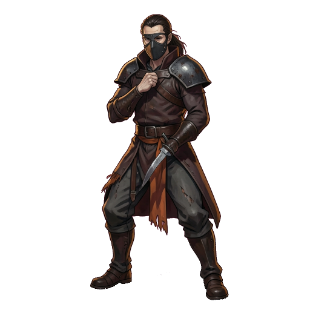

**Ordinario** · 34 HP · Armadura 0 · Resistencia mágica 0 · Debilidad: magia ×1,15 · XP 10  
**Sprite:** `assets/art/characters/ash_brigand.png` · acento de combate `#d9a07e`.

| Habilidad | Tipo | Daño base | Efecto |
|---|---|---:|---|
| Filo ardiente | Ataque | 10 | **Sin efecto** |
| Ceniza en los ojos | Defensa | — | Gana 6 de guardia hasta el próximo golpe recibido. |
| Brasa viva | Ataque · Marca | 6 | Marca al jugador: +2 de daño recibido durante 2 turnos. |

Robó una brasa y desde entonces la brasa lo sigue.

### Guardián de Brasas

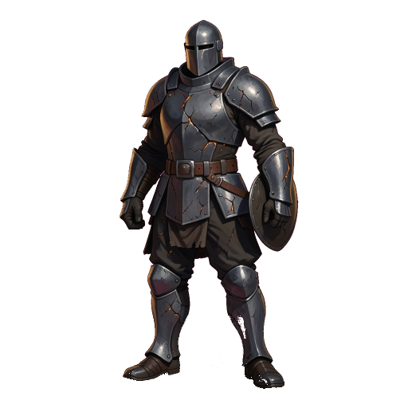

**Fuerte** · 50 HP · Armadura 2 · Resistencia mágica 0 · Debilidad: magia ×1,30 · XP 18  
**Sprite:** `assets/art/characters/cinder_warden.png` · acento de combate `#e09a6c`.

| Habilidad | Tipo | Daño base | Efecto |
|---|---|---:|---|
| Yunque | Ataque | 13 | **Sin efecto** |
| Coraza templada | Defensa | — | Gana 9 de guardia hasta el próximo golpe recibido. |
| Fragua viva | Furia | — | +3 de daño durante 2 turnos. |

Su armadura conserva el calor de una fragua muerta. Si se le deja acumular furia, sus golpes siguientes pesan más.

### Guardián de Hierro

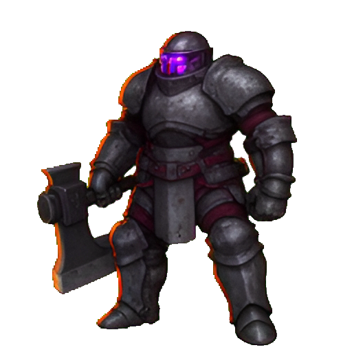

**Fuerte** · 45 HP · Armadura 2 · Resistencia mágica 0 · Debilidad: magia ×1,25 · XP 18  
**Sprite:** `assets/art/characters/warden.png` · sin tinte.

| Habilidad | Tipo | Daño base | Efecto |
|---|---|---:|---|
| Mazazo | Ataque | 12 | **Sin efecto** |
| Muro de hierro | Defensa | — | Gana 9 de guardia hasta el próximo golpe recibido. |
| Embestida | Ataque · Perforación | 8 | Ignora la defensa del jugador. |

Una armadura vacía que sigue cumpliendo una orden olvidada. La embestida castiga las builds que dependen sólo de la defensa.

### Sabueso de Escoria

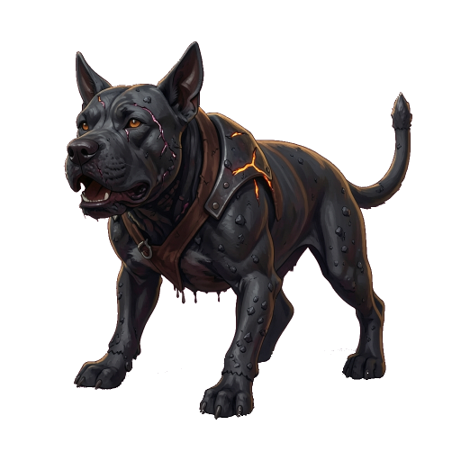

**Ordinario** · 36 HP · Armadura 1 · Resistencia mágica 0 · Debilidad: magia ×1,20 · XP 10  
**Sprite:** `assets/art/characters/slag_hound.png` · retrato propio.

| Habilidad | Tipo | Daño base | Efecto |
|---|---|---:|---|
| Mordida de horno | Ataque | 10 | **Sin efecto** |
| Lomo vitrificado | Defensa | — | Gana 7 de guardia hasta el próximo golpe recibido. |
| Tirón de escoria | Ataque · Múltiple | 5 por golpe | Golpea dos veces con 5 de daño base cada golpe. |

No deja huellas. La piedra se enfría detrás de él. El ataque doble puede consumir el Sello de guarda en un solo turno.

### Sacerdote de Escoria · élite

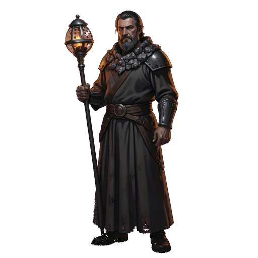

**Élite** · 56 HP · Armadura 1 · Resistencia mágica 2 · Debilidad: física ×1,20 · XP 26  
**Sprite:** `assets/art/characters/slag_priest.png` · acento de combate `#e7b07a`. Aparece como élite de Ceniza desde el encuentro 6.

| Habilidad | Tipo | Daño base | Efecto |
|---|---|---:|---|
| Sermón de escoria | Ataque | 16 | **Sin efecto** |
| Horno protector | Defensa | — | Gana 10 de guardia hasta el próximo golpe recibido. |
| Sacrificio de brasa | Ataque · Drenaje | 8 | Se cura el 75 % del daño infligido. |

Predica desde el horno. Nadie sabe a quién escucha. Su drenaje es el más alto del juego: conviene cerrarle el turno antes de que recupere.

### Coloso de Hueso · miniboss

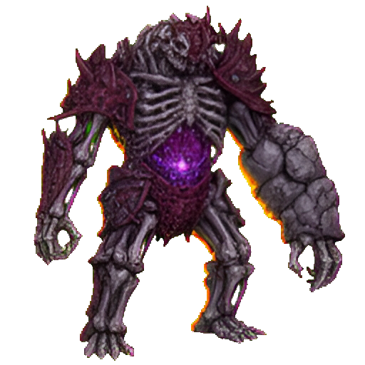

**Miniboss** · 90 HP · Armadura 3 · Resistencia mágica 0 · Debilidad: magia ×1,25 · XP 50  
**Sprite:** `assets/art/characters/colossus.png` · sin tinte. Encuentro 5 fijo, individual.

| Habilidad | Tipo | Daño base | Efecto |
|---|---|---:|---|
| Pisotón | Ataque | 18 | **Sin efecto** |
| Osamenta | Defensa | — | Gana 12 de guardia hasta el próximo golpe recibido. |
| Rugido | Furia | — | +4 de daño durante 3 turnos. |
| Marea de huesos | Ataque · Marca | 12 | Marca al jugador: +3 de daño recibido durante 2 turnos. |

Se alza despacio, como si el pasillo entero se pusiera de pie. Es el primer examen de resistencia de la run: guardia alta, furia acumulable y una marca que castiga quedarse.

## Santuario de la Campana Rota · encuentros 7–9

Pool normal: **Coro Hueco**, **Centinela de la Grieta**, **Peregrino de Hueso** (ficha en la Cripta) y **Polilla de Cal**. Élites desde el encuentro 9: **Guardiana de la Campana** y **Erudito del Espejo** (35 %).

### Coro Hueco

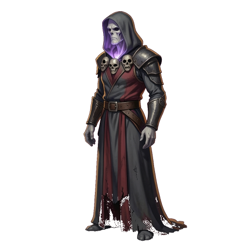

**Ordinario** · 32 HP · Armadura 0 · Resistencia mágica 0 · Debilidad: magia ×1,25 · XP 10  
**Sprite:** `assets/art/characters/hollow_choir.png` · acento de combate `#c9c1d8`.

| Habilidad | Tipo | Daño base | Efecto |
|---|---|---:|---|
| Canto hueco | Ataque | 9 | **Sin efecto** |
| Salmo de guarda | Defensa | — | Gana 6 de guardia hasta el próximo golpe recibido. |
| Coro sanador | Curación | — | Restaura 8 HP al aliado más herido. |

No tiene bocas, pero repite el nombre de la campana. Es el único enemigo ordinario con curación; en grupos alarga la pelea.

### Polilla de Cal

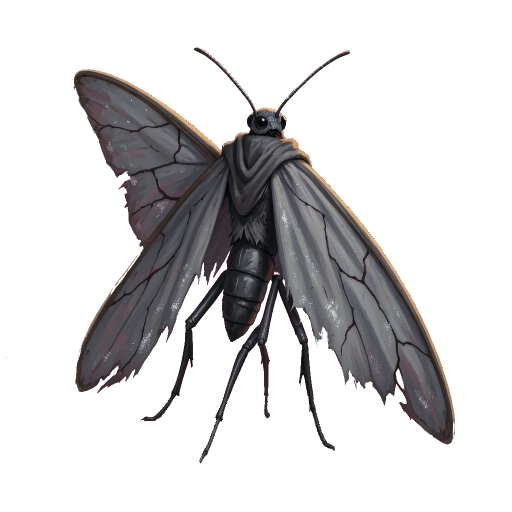

**Ordinario** · 28 HP · Armadura 0 · Resistencia mágica 0 · Debilidad: magia ×1,25 · XP 10  
**Sprite:** `assets/art/characters/chalk_moth.png` · retrato propio.

| Habilidad | Tipo | Daño base | Efecto |
|---|---|---:|---|
| Ala de cal | Ataque | 8 | **Sin efecto** |
| Polvo sin eco | Maldición | — | Reduce un 20 % el daño del jugador durante 2 turnos. |
| Alas cerradas | Defensa | — | Gana 5 de guardia hasta el próximo golpe recibido. |

Sus alas tiemblan; el sonido llega a otra parte. La maldición puede durar más que su frágil cuerpo.

### Centinela de la Grieta

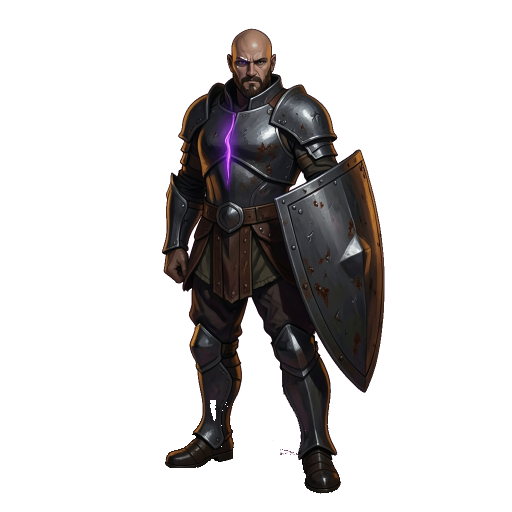

**Fuerte** · 52 HP · Armadura 3 · Resistencia mágica 0 · Debilidad: magia ×1,20 · XP 18  
**Sprite:** `assets/art/characters/rift_sentinel.png` · acento de combate `#b9a6e8`.

| Habilidad | Tipo | Daño base | Efecto |
|---|---|---:|---|
| Lanza de grieta | Ataque | 14 | **Sin efecto** |
| Velo de vacío | Defensa | — | Gana 9 de guardia hasta el próximo golpe recibido. |
| Desgarro | Ataque · Perforación | 9 | Ignora la defensa del jugador. |

Vigila una grieta que no debería existir. Su armadura alta premia el daño mágico y la perforación del Tajo.

### Guardiana de la Campana · élite

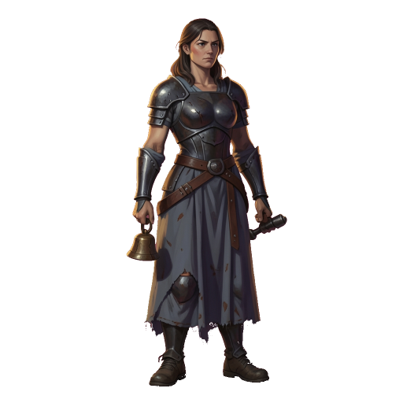

**Élite** · 58 HP · Armadura 2 · Resistencia mágica 1 · Debilidad: física ×1,15 · XP 26  
**Sprite:** `assets/art/characters/bell_keeper.png` · acento de combate `#d8c48e`. Élite del Santuario desde el encuentro 9.

| Habilidad | Tipo | Daño base | Efecto |
|---|---|---:|---|
| Toque de campana | Ataque | 16 | **Sin efecto** |
| Sello de bronce | Defensa | — | Gana 11 de guardia hasta el próximo golpe recibido. |
| Doble tañido | Ataque · Múltiple | 8 por golpe | Golpea dos veces con 8 de daño base cada golpe. |

No toca la campana. Solo escucha lo que responde. El doble golpe consume el escudo del Sello de guarda muy rápido.

### Erudito del Espejo · élite

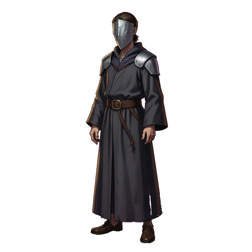

**Élite** · 54 HP · Armadura 2 · Resistencia mágica 2 · Debilidad: física ×1,25 · XP 26  
**Sprite:** `assets/art/characters/mirror_scholar.png` · acento de combate `#a9c9e6`. Élite del Santuario desde el encuentro 9.

| Habilidad | Tipo | Daño base | Efecto |
|---|---|---:|---|
| Copia exacta | Ataque | 15 | **Sin efecto** |
| Reflejo | Defensa | — | Gana 10 de guardia hasta el próximo golpe recibido. |
| Espejismo | Maldición | — | Reduce un 25 % el daño del jugador durante 2 turnos. |

Aprendió a repetir cada límite que alguien rompe. Su maldición castiga las técnicas de un solo golpe y favorece el Barrido.

## Trono de Limitless · encuentro 10

### Limitless · jefe final

**Jefe** · 150 HP · Armadura 4 · Resistencia mágica 1 · Debilidad: ninguna · XP 90  
**Sprite:** `assets/art/characters/limitless.png` · sin tinte. Encuentro 10 fijo, individual.

| Habilidad | Tipo | Daño base | Efecto |
|---|---|---:|---|
| Toque sin nombre | Ataque | 22 | **Sin efecto** |
| Velo | Defensa | — | Gana 15 de guardia hasta el próximo golpe recibido. |
| Susurro del límite | Maldición | — | Reduce un 30 % el daño del jugador durante 2 turnos. |
| Aniquilación | Ataque · Perforación | 26 | Ignora la defensa del jugador. |

No tiene forma fija. Cada vez que lo miras, se parece un poco más a ti. Es el único enemigo con 150 HP, armadura 4 y una maldición del 30 %; la perforación de Aniquilación ignora por completo la defensa del jugador.

## Resumen de datos

| Enemigo | Mundo | Tier | HP | Armadura | Res. mágica | Debilidad | XP |
|---|---|---|---:|---:|---:|---|---:|
| Esqueleto de Cripta | Cripta | Débil | 15 | 0 | 0 | Magia ×1,25 | 5 |
| Acólito del Juramento | Cripta | Débil | 18 | 0 | 0 | Física ×1,15 | 5 |
| Peregrino de Hueso | Cripta / Santuario | Ordinario | 28 | 0 | 0 | Magia ×1,20 | 10 |
| Bandido de la Marca | Cripta | Ordinario | 30 | 0 | 0 | Magia ×1,15 | 10 |
| Cultista Carmesí | Cripta | Élite | 48 | 1 | 2 | Física ×1,20 | 26 |
| Bandido de Ceniza | Ceniza | Ordinario | 34 | 0 | 0 | Magia ×1,15 | 10 |
| Guardián de Brasas | Ceniza | Fuerte | 50 | 2 | 0 | Magia ×1,30 | 18 |
| Guardián de Hierro | Ceniza | Fuerte | 45 | 2 | 0 | Magia ×1,25 | 18 |
| Sacerdote de Escoria | Ceniza | Élite | 56 | 1 | 2 | Física ×1,20 | 26 |
| Coloso de Hueso | Ceniza (encuentro 5) | Miniboss | 90 | 3 | 0 | Magia ×1,25 | 50 |
| Coro Hueco | Santuario | Ordinario | 32 | 0 | 0 | Magia ×1,25 | 10 |
| Centinela de la Grieta | Santuario | Fuerte | 52 | 3 | 0 | Magia ×1,20 | 18 |
| Guardiana de la Campana | Santuario | Élite | 58 | 2 | 1 | Física ×1,15 | 26 |
| Erudito del Espejo | Santuario | Élite | 54 | 2 | 2 | Física ×1,25 | 26 |
| Encadenado de Plomo | Cripta | Ordinario | 31 | 1 | 0 | Magia ×1,15 | 10 |
| Sabueso de Escoria | Ceniza | Ordinario | 36 | 1 | 0 | Magia ×1,20 | 10 |
| Polilla de Cal | Santuario | Ordinario | 28 | 0 | 0 | Magia ×1,25 | 10 |
| Limitless | Trono (encuentro 10) | Jefe | 150 | 4 | 1 | Ninguna | 90 |

## Documentación relacionada

- [Diseño y reglas](GAME_DESIGN.md): combate, técnicas y estados.
- [Personajes](PERSONAJES.md): protagonista, herrero, ángel y jefe.
- [Objetos](OBJETOS.md): equipo y consumibles que cambian estas peleas.
