# Objetos

**Limits Breaker** tiene **26 objetos**: 21 equipables repartidos en tres ranuras (arma, armadura y reliquia) y 5 consumibles. El inventario lleva hasta cuatro objetos sin equipar; arma, armadura y reliquia se guardan en sus propias ranuras y no ocupan esos cuatro espacios.

## Cómo funciona el botín

Cada enemigo derrotado tiene un **35 % de probabilidad** de soltar un objeto. Si suelta, hay un **55 %** de que salga de la tabla temática del mundo y el resto de la tabla de su tier. Las tablas son:

- **Tier débil:** Hoja Oxidada, Bremaje Curativo, Reliquia del Peregrino, Ungüento de Ceniza.
- **Tier ordinario:** Coraza de Hierro, Escudo de Roble, Bremaje Curativo, Talismán de Brasa, Ungüento de Ceniza, Clavo del Umbral, Colmillo de Escoria, Tónico de Cal.
- **Tier fuerte:** Hacha de Ceniza, Placa del Guardián, Sigilo del Vacío, Bremaje Mayor, Filo del Juramento, Mazo de Ceniza, Manto de Ceniza, Escama de Espejo, Manto sin Eco, Elixir Evanescente.
- **Tier élite:** Báculo Arcano, Placa del Guardián, Talismán de Brasa, Bremaje Mayor, Aguja de Espejo, Placa del Coro, Fragmento de Campana, Manto sin Eco, Tónico de Cal, Elixir Evanescente.
- **Tier miniboss:** Hacha de Ceniza, Báculo Arcano, Sigilo del Vacío, Bremaje Mayor, Brasa de la Grieta, Ojo Hueco, Placa del Coro.
- **Tier jefe:** Hacha de Ceniza, Báculo Arcano, Placa del Guardián, Sigilo del Vacío, Brasa de la Grieta, Aguja de Espejo, Ojo Hueco.

Las tablas de mundo son: **Cripta** (Filo del Juramento, Clavo del Umbral, Ungüento de Ceniza, Reliquia del Peregrino, Bremaje Curativo), **Ceniza** (Mazo de Ceniza, Colmillo de Escoria, Manto de Ceniza, Ungüento de Ceniza, Talismán de Brasa, Bremaje Mayor), **Campana** (Aguja de Espejo, Escama de Espejo, Fragmento de Campana, Manto sin Eco, Tónico de Cal, Elixir Evanescente, Ojo Hueco) y **Trono** (Brasa de la Grieta, Placa del Coro, Ojo Hueco, Sigilo del Vacío, Hacha de Ceniza).

## Rareza y sprites

- **Común:** objetos de inicio o de reemplazo directo, sin bonificaciones secundarias.
- **Rara:** objetos con dos o más estadísticas, o con un bonificador de hechizo relevante.

Los iconos son PNG estáticos: once maestros originales y cuatro iconos propios para los objetos añadidos. Las variantes anteriores reutilizan maestros y pueden llevar un **tinte de runtime**; las cuatro imágenes nuevas conservan su color. Algunos objetos llevan una frase breve y ambigua: aparece junto al botín aleatorio y vuelve a leerse en el inventario. Son rastros parciales, no explicaciones completas del mundo.

## Rastros breves

| Objeto | Texto que puede aparecer al hallarlo |
|---|---|
| Filo del Juramento | El juramento sigue; el nombre fue raspado. |
| Reliquia del Peregrino | No señala un destino. Nadie la soltó. |
| Mazo de Ceniza | El mango aún quema. La fragua está fría. |
| Manto de Ceniza | Ceniza por dentro. Limpio por fuera. |
| Sigilo del Vacío | La tinta rodea un hueco que no cubre. |
| Aguja de Espejo | En el espejo, la punta llega primero. |
| Escama de Espejo | El reflejo guarda una forma perdida. |
| Fragmento de Campana | No suena. A lo lejos, alguien calla. |
| Clavo del Umbral | La pared no recuerda qué había al otro lado. |
| Colmillo de Escoria | No parece arrancado. Aún conserva el calor. |
| Manto sin Eco | El polvo no se posa donde debería. |
| Tónico de Cal | Hay algo blanco en el fondo. No cae. |
| Placa del Coro | Varias letras empiezan la misma palabra. |
| Brasa de la Grieta | No alumbra. La ceniza cae hacia arriba. |
| Ojo Hueco | La pupila está vacía. El reflejo, no. |
| Elixir Evanescente | Tres fechas en la etiqueta. Las tres, ilegibles. |

Estos rastros no modifican el efecto mecánico de los objetos ni identifican quién los usó. Su aparición sigue las probabilidades de las tablas de botín de cada mundo.

## Armas

El **daño** de un arma se suma completo a las técnicas físicas (Tajo y Barrido). La Lanza arcana y Nova astral reciben siempre la **mitad del daño del arma**, redondeada hacia abajo; además, en preguntas **Avanzado y Superdifícil**, reciben el **hechizo**. En Fácil e Intermedio no reciben el bonificador de hechizo. El Sello de guarda y Aliento vital nunca hacen daño: el Sello se beneficia de la defensa del equipo y el Aliento cura una cantidad fija según la dificultad.

| Arma | Rareza | Sprite | Tinte | Daño | Hechizo | Efecto |
|---|---|---:|---|---:|---:|---|
| Hoja Oxidada | Común | 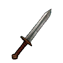 | — | +2 | 0 | +2 físico; +1 a Lanza/Nova. |
| Hacha de Ceniza | Rara | 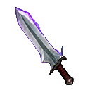 | — | +4 | 0 | +4 físico; +2 a Lanza/Nova. |
| Báculo Arcano | Rara | 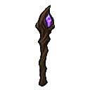 | — | +1 | +4 | +1 físico; +4 mágico a Lanza/Nova en Avanzado/Superdifícil. |
| Filo del Juramento | Rara |  | `#d9c48c` | +3 | +2 | +3 físico; +3 mágico a Lanza/Nova en Avanzado/Superdifícil y +1 en Fácil/Intermedio. |
| Mazo de Ceniza | Rara |  | `#d9a06c` | +5 | 0 | +5 físico; +2 a Lanza/Nova. |
| Aguja de Espejo | Rara |  | `#a9c9e6` | +1 | +5 | +1 físico; +5 mágico a Lanza/Nova en Avanzado/Superdifícil. |
| Clavo del Umbral | Rara | 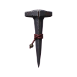 | — | +3 | +1 | +3 físico; +2 mágico a Lanza/Nova en Avanzado/Superdifícil y +1 en Fácil/Intermedio. |

## Armaduras

La defensa reduce el daño enemigo y **cada punto suma 2 al escudo del Sello de guarda**. El HP máximo se aplica de inmediato al equipar; si se desequipa, la vida actual se ajusta al nuevo máximo.

| Armadura | Rareza | Sprite | Tinte | HP máx. | Defensa | Efecto |
|---|---|---:|---|---:|---:|---|
| Coraza de Hierro | Común | 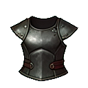 | — | +15 | 0 | +15 HP máximo. |
| Placa del Guardián | Rara | 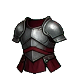 | — | +25 | +1 | +25 HP máximo y +1 de defensa. |
| Escudo de Roble | Común | 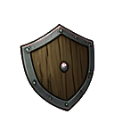 | — | 0 | +2 | +2 de defensa. |
| Manto de Ceniza | Rara |  | `#d9a06c` | +18 | +1 | +18 HP máximo y +1 de defensa. |
| Escama de Espejo | Rara |  | `#a9c9e6` | +12 | +1 | +12 HP máximo y +1 de defensa. |
| Placa del Coro | Rara |  | `#c9c1d8` | +22 | +1 | +22 HP máximo y +1 de defensa. |
| Manto sin Eco | Rara | 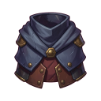 | — | +18 | +1 | +18 HP máximo y +1 de defensa. |

## Reliquias

Las reliquias no tienen ranura de ataque: aportan estadísticas pasivas. Su **daño** se suma a todas las técnicas ofensivas, físicas y mágicas, sin depender de la dificultad. Su **defensa** también suma al escudo del Sello.

| Reliquia | Rareza | Sprite | Tinte | HP máx. | Daño | Defensa | Efecto |
|---|---|---:|---|---:|---:|---:|---|
| Talismán de Brasa | Común | 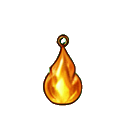 | — | 0 | +2 | 0 | +2 de daño. |
| Sigilo del Vacío | Rara | 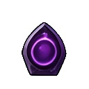 | — | 0 | 0 | +2 | +2 de defensa. |
| Reliquia del Peregrino | Común | 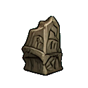 | — | +10 | 0 | 0 | +10 HP máximo. |
| Fragmento de Campana | Rara |  | `#d8c48e` | +15 | +1 | 0 | +15 HP máximo y +1 de daño. |
| Brasa de la Grieta | Rara |  | `#b9a6e8` | 0 | +3 | 0 | +3 de daño. |
| Ojo Hueco | Rara |  | `#a9c9e6` | +8 | 0 | +2 | +8 HP máximo y +2 de defensa. |
| Colmillo de Escoria | Rara | 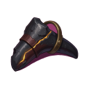 | — | 0 | +2 | +1 | +2 de daño y +1 de defensa. |

## Consumibles

Los consumibles se usan desde el inventario, curan al instante y desaparecen. No se pueden equipar y no ocupan una ranura de arma, armadura o reliquia. La curación respeta el máximo de HP de la run.

| Consumible | Rareza | Sprite | Tinte | Curación | Efecto |
|---|---|---:|---|---:|---|
| Bremaje Curativo | Común | 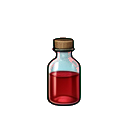 | — | 30 HP | Restaura 30 HP. Se consume. |
| Bremaje Mayor | Rara | 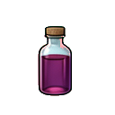 | — | 60 HP | Restaura 60 HP. Se consume. |
| Ungüento de Ceniza | Común |  | `#d9a06c` | 25 HP | Restaura 25 HP. Se consume. |
| Elixir Evanescente | Rara |  | `#b9a6e8` | 75 HP | Restaura 75 HP. Se consume. |
| Tónico de Cal | Común | 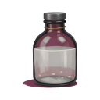 | — | 40 HP | Restaura 40 HP. Se consume. |

## Procedencia por objeto

| Objeto | Categoría | Procedencia |
|---|---|---|
| Hoja Oxidada | Arma | Botín débil. |
| Hacha de Ceniza | Arma | Botín fuerte, miniboss y jefe; mundo Trono. |
| Báculo Arcano | Arma | Botín élite, miniboss y jefe. |
| Filo del Juramento | Arma | Botín fuerte; mundo Cripta. |
| Mazo de Ceniza | Arma | Botín fuerte; mundo Ceniza. |
| Aguja de Espejo | Arma | Botín élite y jefe; mundo Campana. |
| Coraza de Hierro | Armadura | Botín ordinario. |
| Placa del Guardián | Armadura | Botín fuerte, élite y jefe. |
| Escudo de Roble | Armadura | Botín ordinario. |
| Manto de Ceniza | Armadura | Botín fuerte; mundo Ceniza. |
| Escama de Espejo | Armadura | Botín fuerte; mundo Campana. |
| Placa del Coro | Armadura | Botín élite y miniboss; mundo Trono. |
| Talismán de Brasa | Reliquia | Botín ordinario y élite; mundo Ceniza. |
| Sigilo del Vacío | Reliquia | Botín fuerte, miniboss y jefe; mundo Trono. |
| Reliquia del Peregrino | Reliquia | Botín débil; mundo Cripta. |
| Fragmento de Campana | Reliquia | Botín élite; mundo Campana. |
| Brasa de la Grieta | Reliquia | Botín miniboss y jefe; mundo Trono. |
| Ojo Hueco | Reliquia | Botín miniboss y jefe; mundo Campana y Trono. |
| Bremaje Curativo | Consumible | Botín débil y ordinario; mundo Cripta. |
| Bremaje Mayor | Consumible | Botín fuerte, élite y miniboss; mundo Ceniza. |
| Ungüento de Ceniza | Consumible | Botín débil y ordinario; mundos Cripta y Ceniza. |
| Elixir Evanescente | Consumible | Botín fuerte y élite; mundo Campana. |
| Clavo del Umbral | Arma | Botín ordinario; mundo Cripta. |
| Colmillo de Escoria | Reliquia | Botín ordinario; mundo Ceniza. |
| Manto sin Eco | Armadura | Botín fuerte y élite; mundo Campana. |
| Tónico de Cal | Consumible | Botín ordinario y élite; mundo Campana. |

## Documentación relacionada

- [Diseño y reglas](GAME_DESIGN.md): combate, iniciativa, botín y mejoras.
- [Personajes](PERSONAJES.md): protagonista, herrero, ángel y jefe.
- [Enemigos](ENEMIGOS.md): dónde aparece cada objeto y qué habilidades lo acompañan.
