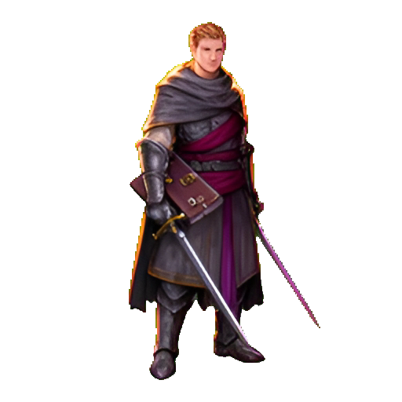
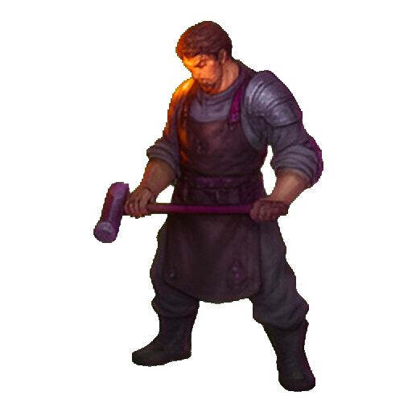
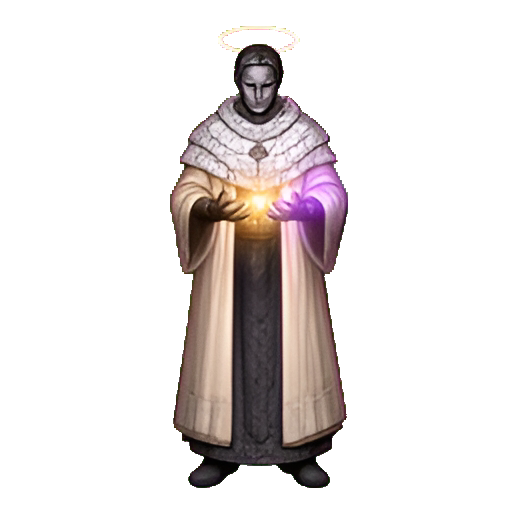
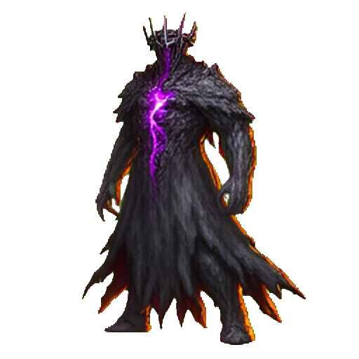

# Personajes

Los personajes de **Limits Breaker** cumplen una función concreta en la run: el jugador combate y resuelve límites; el herrero y el ángel administran las pausas entre combates; Limitless cierra el descenso. Los enemigos tienen su propio catálogo en [ENEMIGOS.md](ENEMIGOS.md).

| Personaje | Tipo | Aparición | Función |
|---|---|---|---|
| El Rompe-límites | Protagonista | Toda la run | Combatir, resolver los límites y avanzar por los cuatro mundos |
| El Herrero | NPC de la fragua | Encuentros 4 y 8 | Ofrecer una mejora permanente a cambio de un reto de trigonometría |
| El Ángel | NPC raro | Desde el encuentro 3, 6 % y una vez por run | Curar según la dificultad a cambio de una factorización |
| Limitless | Jefe final | Encuentro 10 | Cerrar la run; derrotarlo completa el hito de victoria |

## El Rompe-límites

- **Sprite:** `assets/art/characters/player.png` (PNG estático con alfa; se recorta en runtime).
- **Silueta:** espada corta, cuaderno de campo cerrado al cinturón, capa compacta y hombreras de acero. La paleta mezcla carbón, acero, borgoña y un violeta mínimo; el gesto es de cansancio alerta, no de heroísmo triunfal.
- **Nombre visible:** la interfaz lo llama **Rompe-límites** en el HUD y **El que rompe límites** en el menú. No se le asigna un nombre propio.

### Función en el juego

Es el único personaje controlable. Desciende desde el Encuentro I hasta el Trono de Limitless resolviendo operaciones de límites, derivadas laterales, gráficas, tablas y factorización. Su progreso dentro de la run combina tres capas:

- **Vida:** 100 HP base. Las armaduras, reliquias y mejoras del herrero pueden ampliar el máximo.
- **Defensa:** 0 base. La aportan el equipo, las reliquias y la mejora de encantamiento; además, cada punto de defensa suma 2 al escudo del Sello de guarda.
- **Nivel de run:** empieza en 1 y llega hasta 10 con la XP de los enemigos derrotados. El nivel amplía las bandas de dificultad de las técnicas; no se conserva entre runs.

### Técnicas

| Técnica | Tipo | Función |
|---|---|---|
| Tajo perforante | Físico, 1 objetivo | 1,00× de daño y ajuste +1; atraviesa 2 de armadura. |
| Barrido | Físico, hasta 2 objetivos | 0,78× de daño y ajuste 0; alcanza al objetivo y al siguiente enemigo vivo. |
| Lanza arcana | Mágico, 1 objetivo | 1,00× de daño y ajuste +1; atraviesa 1 de resistencia mágica. |
| Nova astral | Mágico, hasta 4 objetivos | 0,54× de daño y ajuste −1; alcanza a todos los enemigos vivos y les aplica Frágil +2 durante 2 turnos. |
| Sello de guarda | Defensa, propio | No hace daño. Otorga 12/18/26/34 de escudo según la dificultad, más 2 por punto de defensa; absorbe los ataques enemigos y conserva cualquier remanente hasta dos turnos adicionales. |
| Aliento vital | Curación, propio | No hace daño. Cura 7/10/13/16 HP según la dificultad; los enemigos siguen actuando. |

El Tajo y la Lanza comparten fuerza base y dificultad: la diferencia sale del tipo de daño, de la penetración, de las debilidades del enemigo y del arma equipada. El Tajo recibe el daño completo del arma; la Lanza recibe siempre la mitad y, en Avanzado/Superdifícil, también su hechizo. Nova astral es el ataque de área que prepara el siguiente turno con Frágil.

El **Berserk** se carga durante siete turnos de combate y se conserva al cambiar de encuentro. Al activarlo, un acierto multiplica por 1,5 el daño, el escudo o la curación; un fallo conserva el 0,4× y las penalizaciones normales. El turno de activación cuenta para la siguiente carga.

### Papel narrativo

El Rompe-límites no es un elegido: es alguien que anota, mide y vuelve a intentar. Cada respuesta correcta abre una puerta del pasillo; cada error deja una cicatriz en la run. Esa mezcla de estudioso y combatiente explica su silueta: arma corta para sobrevivir, cuaderno para entender.

## El Herrero

- **Sprite:** `assets/art/characters/blacksmith.png` (PNG estático con alfa).
- **Silueta:** delantal de cuero, antebrazos descubiertos, martillo y hombros anchos. La luz ámbar de la fragua le recorta las manos y el delantal.
- **Aparición:** la fragua se abre en los encuentros **4 y 8** (cada cuatro encuentros a partir del cuarto). Es un evento entre combates, nunca durante una pelea.

### Función en el juego

Ofrece **una sola mejora por visita**, elegida entre tres opciones. Para cobrarla, el jugador debe resolver un reto de trigonometría. La mejora es permanente durante la run actual y se pierde al morir o terminar la run.

| Mejora | Efecto |
|---|---|
| Templar el arma | +2 de daño permanente en esta run. |
| Reforzar la armadura | +12 HP máximo y cura 12 HP. |
| Encantar la reliquia | +2 de defensa permanente en esta run. |

El herrero no vende objetos ni acepta oro: su moneda es entender qué hace el calor sobre el acero. La frase que abre el evento es «El metal obedece a quien entiende».

## El Ángel

- **Sprite:** `assets/art/characters/angel.png` (PNG estático con alfa).
- **Silueta:** halo fino, ropas verticales de piedra pálida, manos abiertas y alas ausentes. La paleta es marfil, oro cálido y violeta pálido; la expresión es serena e inquietante.
- **Aparición:** desde el **encuentro 3**, con **6 % de probabilidad** por descanso y **como máximo una vez por run**. También es un evento entre combates.

### Función en el juego

Plantea una **factorización** con dos raíces. Si el jugador acierta, recupera HP según la dificultad del ejercicio; si falla, recupera exactamente 1 HP. No combate, no vende nada y no otorga objetos.

| Dificultad del reto | Curación |
|---|---:|
| Fácil | 20 HP |
| Intermedio | 35 HP |
| Avanzado | 50 HP |
| Superdifícil | 70 HP |

La curación respeta el máximo de HP de la run. El ángel no pide fe: «La luz no juzga la respuesta: mide lo que entendiste».

## Limitless

- **Sprite:** `assets/art/characters/limitless.png` (PNG estático con alfa).
- **Silueta:** corona de hierro rota, manto negro desgarrado, una grieta violeta contenida en el pecho y una forma vertical que parece mitad humana y mitad polvo de piedra.
- **Aparición:** encuentro **10**, el Trono de Limitless. Es el jefe final y no comparte encuentro con otros enemigos.

### Función en el juego

Es el antagonista y la prueba final. Tiene **150 HP**, **4 de armadura**, **1 de resistencia mágica** y cuatro habilidades: ataque básico, defensa, maldición y un ataque que perfora la defensa. Derrotarlo completa el hito de victoria de la run. Su frase de cierre en la pantalla de victoria es: «Limitless cae. Por primera vez, el pasillo termina.»

## Relación con el resto de la documentación

- [Diseño y reglas](GAME_DESIGN.md): bucle de run, combate, técnicas y estados.
- [Enemigos](ENEMIGOS.md): los dieciocho enemigos, sus kits y sus sprites.
- [Objetos](OBJETOS.md): equipo, consumibles, rarezas y efectos.
